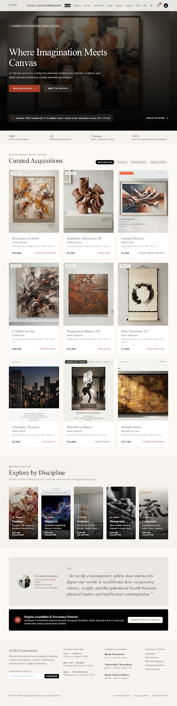

# AURA Contemporain – Contemporary Art Gallery & Portfolio

A curated contemporary art gallery portfolio website featuring modern monographs, curated masterworks, and site-specific spatial installations.

## 🎨 Features
- **Atmospheric Gallery Wall Hero Section**
- **Curated Acquisitions & Salon Showcase**
- **Artist Disciplines & Profiles**
- **Responsive Layout** crafted with Tailwind CSS and elegant typography (Playfair Display & Inter)
- **Direct Art Inquiry Modal**

## 🚀 How to Run Locally
1. Clone or download this repository.
2. Open index.html directly in your web browser, or run a local HTTP server:
   `ash
   python -m http.server 8080
   `
3. Open http://localhost:8080 in your browser.

---
Maintained by [@asadmalghani04-beep](https://github.com/asadmalghani04-beep)